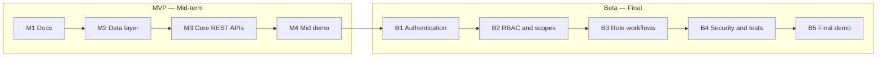

# Product Requirements Document (PRD) — Apartment Building Management System

| Field | Value |
|---|---|
| Product | Apartment Building Management System (ApartmentCare) |
| Version | MVP + Beta |
| Releases | MVP — Mid-term, Beta — Final |
| Status | Draft |
| Related docs | [Software Requirements Specification (SRS)](02-srs.md), [Technical Design Document (TDD)](03-tdd.md) |

This document covers **both releases**. Every goal, feature, and user story has a **Release** column so it is clear what is planned for the mid-term and what is added for the final demonstration.

**Documents in this set**

| Short form | Full form | Purpose | File |
|---|---|---|---|
| PRD | Product Requirements Document | What we build and why (this document) | [01-prd.md](01-prd.md) |
| SRS | Software Requirements Specification | Exact requirements, permissions, and acceptance criteria | [02-srs.md](02-srs.md) |
| TDD | Technical Design Document | How we build it: architecture, data model, and API | [03-tdd.md](03-tdd.md) |

## 0. Release plan

| Release | When | Focus |
|---|---|---|
| **MVP** | Mid-term | Core apartment operations: maintenance-request CRUD, visitor entry/exit records, notices, database, and REST API running locally |
| **Beta** | Final | Authentication, role-based access control (RBAC), security scopes/permissions, maintenance assignment, role-specific dashboard, expense transparency, security hardening, and deployment |

## 1. Purpose

ApartmentCare is a web application for coordinating routine apartment-building operations. The project will be developed in two clear steps:

1. **MVP (mid-term):** build a small, working application with REST APIs for maintenance-request CRUD, visitor entry/exit records, and building notices, backed by a database and usable through a React frontend.
2. **Beta (final):** extend the MVP into a multi-role application with user accounts, RBAC, security scopes/permissions, maintenance assignment, role-specific dashboards, and basic building-expense transparency.

The project will prioritize a complete and understandable application over a large set of unfinished features.

## 2. Problem statement

Apartment buildings often coordinate maintenance problems, visitor records, announcements, and expenses through phone calls, paper registers, and messaging groups. This can make it difficult to follow maintenance progress, find visitor information, communicate important notices, and review building expenses transparently.

ApartmentCare will bring these routine tasks into one web application. Each type of user will have access appropriate to their responsibilities, and the Beta release will protect private information through backend-enforced authentication and authorization.

## 3. Goals

| ID | Goal | Release |
|---|---|---|
| G-1 | Provide REST APIs to create, view, update, and delete maintenance requests using consistent conventions. | MVP |
| G-2 | Store maintenance requests, visitor records, and notices in a database so data persists across application restarts. | MVP |
| G-3 | Allow the operator to record visitor entry and exit times. | MVP |
| G-4 | Provide basic building-notice management through REST APIs. | MVP |
| G-5 | Provide API documentation through FastAPI's OpenAPI/Swagger interface. | MVP |
| G-6 | Provide a React + TypeScript frontend connected to the FastAPI backend. | MVP |
| G-7 | Give users authenticated accounts and role-appropriate access. | Beta |
| G-8 | Enforce roles, security scopes/permissions, and resource-level access rules on the backend. | Beta |
| G-9 | Allow managers to assign maintenance requests to maintenance staff and track progress. | Beta |
| G-10 | Allow committee members to review building-expense records and summaries. | Beta |
| G-11 | Protect user and visitor information using secure configuration and appropriate access controls. | Beta |
| G-12 | Deploy the application for the final demonstration. | Beta |

## 4. Target users

| User | Need | Release |
|---|---|---|
| Resident | Submit maintenance issues, track their own requests, and read building notices. | MVP/Beta |
| Building manager | Coordinate maintenance, manage operational records, and publish notices. | MVP/Beta |
| Security guard | Quickly record visitor arrivals and departures from a shared phone or tablet. | MVP/Beta |
| Maintenance staff | View assigned jobs and update their work status. | Beta |
| Committee member | Review building-expense records and summaries for transparency. | Beta |
| Instructor / reviewer | Try the API through its documentation interface and review the project implementation. | MVP/Beta |

In the **MVP**, the application is a controlled local demonstration and does not yet enforce the complete account and permission model. In the **Beta**, authenticated users receive role-appropriate access, and private records are restricted by role and ownership.

## 5. Scope

### In scope — MVP (mid-term)

- Create, list, view, update, and delete maintenance requests.
- Track a maintenance request's status.
- Record visitor entry details and update exit time.
- Create, list, update, and delete building notices.
- Validate inputs and return clear API error responses.
- Store application data in PostgreSQL.
- Provide interactive API documentation through FastAPI.
- Connect the React + TypeScript frontend to the FastAPI REST API.
- Run the application locally for the mid-term demonstration.

### In scope — Beta (final)

- **Authentication:** register or provision accounts and log in/log out.
- **User profile:** view a profile and role-appropriate dashboard.
- **RBAC:** Resident, Building Manager, Security Guard, Maintenance Staff, and Committee Member roles.
- **Security scopes/permissions:** check permitted actions on protected backend endpoints.
- **Maintenance workflow:** managers assign jobs; maintenance staff update assigned work and notes; residents view their own requests.
- **Visitor permissions:** guards record entries and exits; other roles see only records permitted by building policy.
- **Notices:** authorized managers publish and manage notices; residents can read them.
- **Expense transparency:** authorized managers record expenses; committee members review records and summaries.
- **Security:** hashed passwords, secrets stored outside source control, server-side authorization, input validation, and tests for access restrictions.
- **Deployment:** deploy the application and document setup/configuration.

### Out of scope for this semester

- Online rent or maintenance-fee payments and payment-gateway integration.
- Smart locks, biometric entry, CCTV integration, or hardware access control.
- Native Android/iOS applications.
- AI, machine learning, chatbots, or predictive analytics.
- Complex accounting, tax calculation, or full financial management.
- Multi-building SaaS management.
- SMS, email, or push notifications.
- Real-time GPS tracking or QR-based visitor access.
- Advanced analytics and custom reporting beyond basic expense summaries.

## 6. Features and priority (MoSCoW)

Priorities are per release: a Beta **Must** is required for the final demonstration, not necessarily for the mid-term.

| ID | Feature | Release | Priority |
|---|---|---|---|
| F-1 | Create a maintenance request | MVP | Must |
| F-2 | List and view maintenance requests | MVP | Must |
| F-3 | Update a request and its status | MVP | Must |
| F-4 | Delete a maintenance request in the controlled MVP environment | MVP | Should |
| F-5 | Record visitor entry and exit | MVP | Must |
| F-6 | Create, list, update, and delete building notices | MVP | Must |
| F-7 | Input validation and clear error responses | MVP | Must |
| F-8 | PostgreSQL persistence and database schema | MVP | Must |
| F-9 | API documentation and health-check endpoint | MVP | Should |
| F-10 | React + TypeScript pages integrated with the API | MVP | Must |
| F-11 | User authentication and secure password storage | Beta | Must |
| F-12 | Five user roles with backend RBAC checks | Beta | Must |
| F-13 | Security scopes/permissions and resource ownership checks | Beta | Must |
| F-14 | Manager assigns maintenance requests to staff | Beta | Must |
| F-15 | Maintenance staff view assigned jobs and update status | Beta | Must |
| F-16 | Role-specific dashboard and user profile | Beta | Should |
| F-17 | Manager creates and committee reviews expense records | Beta | Should |
| F-18 | Visitor-record access restricted by role | Beta | Must |
| F-19 | Automated tests for core workflows and authorization | Beta | Must |
| F-20 | Deploy application for final demonstration | Beta | Must |

## 7. User stories

### MVP

| ID | Story | Feature |
|---|---|---|
| US-01 | As a resident, I want to submit a maintenance request, so the building manager knows what needs fixing. | F-1 |
| US-02 | As a user, I want to view maintenance requests, so I can check the recorded issues. | F-2 |
| US-03 | As a user, I want to update a request's details or status, so the information stays current. | F-3 |
| US-04 | As an operator, I want to record a visitor's arrival, so the building has an entry record. | F-5 |
| US-05 | As a security guard, I want to record a visitor's exit time, so the visitor log shows when the visit ended. | F-5 |
| US-06 | As a building manager, I want to publish a building notice, so residents can learn about important updates. | F-6 |
| US-07 | As a frontend developer, I want consistent API responses and validation errors, so I can handle results clearly in the interface. | F-7 |
| US-08 | As an instructor or reviewer, I want API documentation and a health check, so I can inspect and verify the running backend. | F-9 |
| US-09 | As a resident or building staff member, I want a simple web interface connected to the API, so I can use the core features without manually sending API requests. | F-10 |

### Beta

| ID | Story | Feature |
|---|---|---|
| US-10 | As a user, I want to log in securely, so only authenticated users can access protected features. | F-11 |
| US-11 | As a resident, I want to see only my own private maintenance requests, so my information is not exposed to other residents. | F-13 |
| US-12 | As a building manager, I want to assign a maintenance request to a staff member, so responsibility for the work is clear. | F-14 |
| US-13 | As maintenance staff, I want to see my assigned jobs and update their status, so residents and managers can follow progress. | F-15 |
| US-14 | As a security guard, I want permission to record visitor entry and exit without access to financial records, so I can perform gate duties safely. | F-12, F-18 |
| US-15 | As a building manager, I want to create and manage notices, so residents receive accurate building information. | F-12 |
| US-16 | As a committee member, I want to review expense records and totals, so I can monitor the use of building funds. | F-17 |
| US-17 | As a user, I want a profile page with my permitted account information, so I can understand my account and role. | F-16 |
| US-18 | As an authorized user, I want the system to reject actions outside my permissions, so private records and restricted operations remain protected. | F-12, F-13 |
| US-19 | As a project reviewer, I want automated tests for important workflows and access rules, so I can verify that the application behaves as expected. | F-19 |
| US-20 | As an instructor or reviewer, I want the Beta application deployed, so I can test it without setting up the whole project locally. | F-20 |

## 8. Success metrics

### MVP

- Maintenance-request create, read, update, and delete operations work through the REST API.
- Visitor entry can be recorded and later updated with an exit time.
- Building notices can be created and retrieved through the API.
- Data persists in PostgreSQL after the application restarts.
- The React + TypeScript frontend can complete the core workflows using the FastAPI backend.
- FastAPI's API documentation displays the available endpoints and request schemas.

### Beta

- Each of the five roles can perform its permitted actions and is denied restricted actions.
- A resident cannot read or modify another resident's private maintenance request by changing a record ID.
- Maintenance staff can update assigned work but cannot arbitrarily assign requests.
- A security guard cannot create or edit expense records.
- Committee members can review expense records but cannot change them without explicit permission.
- Passwords are not stored or returned in plaintext, and secrets are not committed to GitHub.
- Core workflows and critical authorization rules have automated test coverage.
- The application is deployed and usable for the final demonstration.

## 9. Assumptions and constraints

- The initial version manages **one apartment building**.
- The required stack is React with TypeScript for the frontend and FastAPI with Python for the backend.
- PostgreSQL is the planned database.
- The MVP runs locally; deployment is planned for Beta.
- The five roles are Resident, Building Manager, Security Guard, Maintenance Staff, and Committee Member.
- Role and ownership checks must be enforced on the backend; hiding buttons in the frontend is not sufficient.
- The project must remain small enough to complete within the course timeline.
- Exact account-provisioning rules and visitor-record visibility will be confirmed before implementation.
- The project is shared as a domain idea across courses, but each course's team, authorship, and submission rules must still be followed.

## 10. Milestones

### MVP — Mid-term

| Milestone | Deliverable |
|---|---|
| M1 — Docs | PRD, SRS, and TDD covering both MVP and Beta reviewed |
| M2 — Data layer | PostgreSQL connection and models for maintenance requests, visitors, and notices |
| M3 — Core API | REST endpoints with validation and useful error responses |
| M4 — Frontend integration | React + TypeScript pages connected to the API |
| M5 — Mid-term demo | Core workflows run locally and can be demonstrated |

### Beta — Final

| Milestone | Deliverable |
|---|---|
| B1 — Authentication | User accounts, login, password hashing, and profile endpoint |
| B2 — RBAC and scopes | Five roles, action permissions, and resource ownership checks |
| B3 — Role workflows | Maintenance assignment, staff status updates, and role-specific dashboard |
| B4 — Expense transparency | Expense recording and committee read-only review |
| B5 — Security and testing | Validation, authorization tests, configuration review, and critical workflow tests |
| B6 — Final demo | Application deployed and final documentation updated |

## 11. Release dependencies

- The Beta builds on the MVP; the core maintenance, visitor, and notice API concepts remain, while protected operations gain authentication and authorization.
- The database schema will evolve as accounts, assignments, and expenses are added. Use versioned migrations when database migrations are introduced.
- Frontend role-aware navigation depends on the backend exposing the authenticated user's role, but the backend remains the authority for permissions.
- Expense functionality should be implemented only after the core MVP and required authentication/authorization workflows are stable.
- Final API paths and field names will be recorded consistently in the SRS and TDD.
