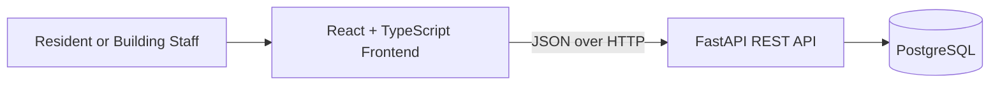
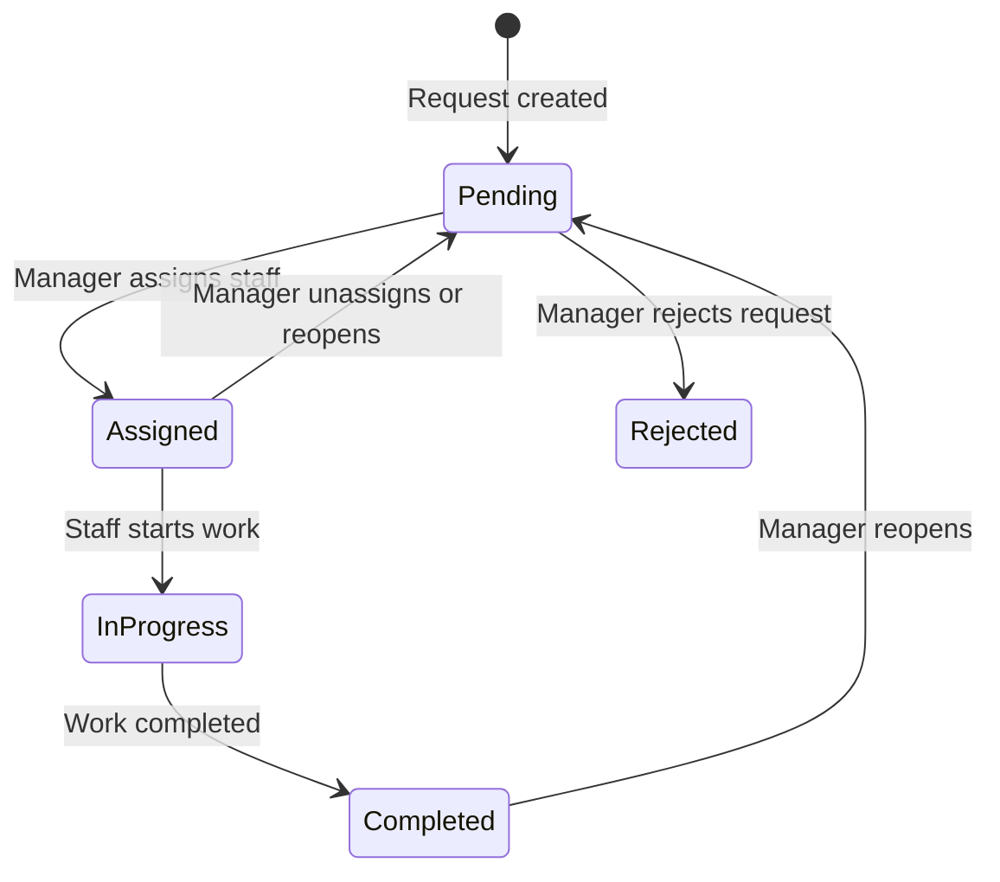

# Software Requirements Specification (SRS) — ApartmentCare

| Field | Value |
|---|---|
| Product | Apartment Building Management System (ApartmentCare) |
| Version | MVP + Beta |
| Releases | MVP — Mid-term, Beta — Final |
| Status | Draft |
| Related docs | [Product Requirements Document (PRD)](01-prd.md), [Technical Design Document (TDD)](03-tdd.md) |

Every requirement has a **Release** column: **MVP** is built for the mid-term; **Beta** is added for the final.

**Documents in this set**

| Short form | Full form | Purpose | File |
|---|---|---|---|
| PRD | Product Requirements Document | What we build and why | [01-prd.md](01-prd.md) |
| SRS | Software Requirements Specification | Exact requirements, permissions and acceptance criteria (this document) | [02-srs.md](02-srs.md) |
| TDD | Technical Design Document | How we build it: architecture, data model and API | [03-tdd.md](03-tdd.md) |

## 1. Introduction

### 1.1 Purpose
This document defines the functional and non-functional requirements for ApartmentCare. The MVP covers maintenance requests, visitor entry/exit records, and building notices. The Beta adds authentication, five roles, backend-enforced RBAC and security permissions, maintenance assignment, and basic expense transparency.

### 1.2 Scope
- **MVP:** a locally running React + TypeScript frontend and FastAPI REST API backed by PostgreSQL. Core records can be created, viewed, updated and, where applicable, deleted. The MVP is a controlled demonstration and does not yet provide complete user authentication.
- **Beta:** authenticated users receive permissions based on their role and record ownership. Managers assign maintenance work; staff update assigned work; committee members review expenses.
- **Out of scope:** online payments, smart locks, CCTV integration, native mobile apps, AI features, and multi-building SaaS.

### 1.3 Definitions

| Term | Meaning |
|---|---|
| CRUD | Create, Read, Update, Delete |
| REST | An API style using HTTP methods to work with resources |
| Resident | A person living in the apartment building |
| Building Manager | The person coordinating building operations and notices |
| Security Guard | A staff member recording visitor arrivals and departures |
| Maintenance Staff | A person assigned to repair or maintenance jobs |
| Committee Member | A member authorized to review building expenses |
| RBAC | Role-Based Access Control: access depends on a user's role |
| Permission / scope | A specific action the authenticated user is allowed to perform |
| JWT | JSON Web Token used to authenticate API requests |
| API | Application Programming Interface |
| MVP / Beta | Mid-term release / final release |

## 2. Overall description

### 2.1 System context

The frontend calls the backend API. The backend validates requests, applies business rules, checks permissions in the Beta release, and reads or writes data in PostgreSQL.

### 2.2 Users and roles

| Role | Release | Description |
|---|---|---|
| Demo operator / client | MVP | Uses the controlled local demonstration; full role enforcement is not yet enabled |
| Guest | Beta | Not logged in; can register or log in only |
| Resident | Beta | Creates maintenance requests, views own requests, and reads notices |
| Building Manager | Beta | Manages maintenance requests, assigns work, manages notices, and records expenses |
| Security Guard | Beta | Records visitor entry and exit and views permitted visitor records |
| Maintenance Staff | Beta | Views assigned jobs and updates their work status and notes |
| Committee Member | Beta | Reads expense records and summaries for oversight |

In the Beta, each account has one global role. The backend checks permissions on every protected request. The frontend may hide unavailable actions for usability, but frontend visibility is not a security boundary.

### 2.3 Use cases

**MVP**
- Create, list, view, update, and delete maintenance requests.
- Record a visitor's arrival and update the visitor's exit time.
- Create, list, update, and delete building notices.
- Check backend health and inspect interactive API documentation.

**Beta**
- Register/log in/log out and view own profile.
- Perform permitted actions according to the five roles.
- Assign maintenance requests to staff and update progress.
- Restrict visitor records to authorized users.
- Create expense records and allow committee members to review them.
- Reject unauthorized requests with appropriate HTTP status codes.

### 2.4 Constraints
- C-1: Frontend uses React with TypeScript.
- C-2: Backend uses Python and FastAPI.
- C-3: PostgreSQL is the planned persistent database.
- C-4: Frontend-backend communication uses REST endpoints and JSON.
- C-5: API routes use the `/api` prefix; versioned business routes use `/api/v1`.
- C-6: MVP runs locally; deployment is planned for Beta.
- C-7: Beta authorization must be enforced on the backend.
- C-8: Secrets and database credentials must not be committed to source control.

### 2.5 Assumptions
- A-1: The first version manages one apartment building.
- A-2: Building accounts are created through registration or manager-controlled provisioning; the final onboarding rule will be confirmed before implementation.
- A-3: Sample/demo visitor and expense records may be used for coursework demonstrations.
- A-4: The application has low traffic and is intended for course assessment.
- A-5: Only the fields listed in this SRS are required for the initial releases.

## 3. Functional requirements

### 3.1 Maintenance requests — MVP

| ID | Requirement | Release | Story |
|---|---|---|---|
| FR-01 | The system shall create a maintenance request with a title, description, category and location. | MVP | US-01 |
| FR-02 | The system shall list maintenance requests, newest first. | MVP | US-02 |
| FR-03 | The system shall return one maintenance request by ID. | MVP | US-02 |
| FR-04 | The system shall update the request's permitted fields and status. | MVP | US-03 |
| FR-05 | The system shall delete a maintenance request in the controlled MVP demonstration. | MVP | US-03 |
| FR-06 | A new request shall have status `Pending` and a creation timestamp. | MVP | US-01 |
| FR-07 | The system shall validate required fields and reject invalid input with `422`. | MVP | US-01 |
| FR-08 | The system shall return `404` when a requested maintenance ID does not exist. | MVP | US-02 |

### 3.2 Visitor records — MVP

| ID | Requirement | Release | Story |
|---|---|---|---|
| FR-09 | The system shall record a visitor's name, destination unit, purpose and entry time. | MVP | US-04 |
| FR-10 | The system shall list visitor records for the controlled demonstration. | MVP | US-04 |
| FR-11 | The system shall record the exit time when a visitor leaves. | MVP | US-05 |
| FR-12 | The system shall prevent an exit time earlier than the entry time. | MVP | US-05 |
| FR-13 | The system shall return `404` for an unknown visitor-record ID. | MVP | US-05 |

### 3.3 Building notices — MVP

| ID | Requirement | Release | Story |
|---|---|---|---|
| FR-14 | The system shall create a notice with a title, body and publication timestamp. | MVP | US-06 |
| FR-15 | The system shall list notices newest first and return a notice by ID. | MVP | US-06 |
| FR-16 | The system shall update or delete a notice in the controlled MVP demonstration. | MVP | US-06 |
| FR-17 | The system shall reject a notice with a missing title or body. | MVP | US-06 |

### 3.4 Health and API documentation — MVP

| ID | Requirement | Release | Story |
|---|---|---|---|
| FR-18 | The system shall expose `GET /api/health` returning `{"status":"ok"}` when the backend is running. | MVP | US-08 |
| FR-19 | The system shall expose interactive API documentation at `/api/docs`. | MVP | US-08 |
| FR-20 | The frontend shall call the backend REST API and show success, loading and error states for core workflows. | MVP | US-09 |

### 3.5 Authentication and profile — Beta

| ID | Requirement | Release | Story |
|---|---|---|---|
| FR-21 | The system shall allow a user to log in with valid credentials. | Beta | US-10 |
| FR-22 | The system shall allow a user to log out and invalidate the applicable session/token. | Beta | US-10 |
| FR-23 | The system shall return the authenticated user's ID, name, email and role without returning a password or password hash. | Beta | US-17 |
| FR-24 | Protected endpoints shall return `401` when the caller is unauthenticated or the token is invalid or expired. | Beta | US-10 |
| FR-25 | The system shall store passwords as secure hashes and never log or return plaintext passwords. | Beta | US-10 |

### 3.6 Roles, permissions and resource access — Beta

| ID | Requirement | Release | Story |
|---|---|---|---|
| FR-26 | The system shall support the roles Resident, Building Manager, Security Guard, Maintenance Staff and Committee Member. | Beta | US-14 |
| FR-27 | The backend shall check the caller's role and required permission/scope for each protected operation. | Beta | US-18 |
| FR-28 | A resident shall be able to create maintenance requests and view their own private requests. | Beta | US-11 |
| FR-29 | A building manager shall be able to view and coordinate building maintenance requests and assign a request to maintenance staff. | Beta | US-12 |
| FR-30 | Maintenance staff shall be able to view requests assigned to them and update permitted status/work notes. | Beta | US-13 |
| FR-31 | A security guard shall be able to create visitor records and record visitor exit times, but shall not manage expense records. | Beta | US-14 |
| FR-32 | Residents shall be able to read published notices; only authorized managers may create, update or delete notices. | Beta | US-15 |
| FR-33 | A building manager shall be able to create expense records. | Beta | US-16 |
| FR-34 | A committee member shall be able to view expense records and summaries but shall not edit or delete them by default. | Beta | US-16 |
| FR-35 | The system shall return `403` when an authenticated user lacks permission for an action. | Beta | US-18 |
| FR-36 | The system shall not disclose another resident's private maintenance request to an unauthorized resident. | Beta | US-11 |

### 3.7 Validation rules

| Field | Rule | Release |
|---|---|---|
| Maintenance title | Required; 1–150 characters after trimming | MVP |
| Maintenance description | Required; 1–2000 characters | MVP |
| Maintenance category | Required; short text up to 80 characters | MVP |
| Maintenance location | Required; e.g. unit number or common area, up to 100 characters | MVP |
| Maintenance status | `Pending`, `Assigned`, `In Progress`, `Completed`, `Rejected` | MVP/Beta |
| Visitor name | Required; 1–120 characters | MVP |
| Destination unit | Required; up to 50 characters | MVP |
| Visitor purpose | Required; up to 200 characters | MVP |
| Entry/exit time | Valid date-time; exit cannot precede entry | MVP |
| Notice title | Required; 1–150 characters | MVP |
| Notice body | Required; 1–3000 characters | MVP |
| Email | Valid email format and unique per account | Beta |
| Password | Minimum 8 characters; stored as a secure hash | Beta |
| Role | One of the five defined roles | Beta |
| Expense amount | Positive decimal amount | Beta |
| Expense description | Required; 1–300 characters | Beta |

### 3.8 Maintenance request states

The MVP may update status through the controlled API. In the Beta, the backend restricts transitions according to the caller's role and assignment.

### 3.9 Permission matrix — Beta

| Action | Resident | Building Manager | Security Guard | Maintenance Staff | Committee Member |
|---|---|---|---|---|---|
| Log in / log out / view own profile | Yes | Yes | Yes | Yes | Yes |
| Create maintenance request | Yes | Yes | No by default | No by default | No by default |
| View own maintenance requests | Yes | Yes | No | Assigned only | No by default |
| View/manage building maintenance requests | Own requests only | Yes | No | Assigned only | No by default |
| Assign maintenance staff | No | Yes | No | No | No |
| Update assigned job status/work notes | No | Yes | No | Yes, assigned jobs only | No |
| Record visitor entry/exit | No | Yes | Yes | No | No |
| Read visitor records | No by default | Yes | Yes, operational records | No by default | No by default |
| Read published notices | Yes | Yes | Yes | Yes | Yes |
| Create/update/delete notices | No | Yes | No | No | No |
| Create expense record | No | Yes | No | No | No |
| View expense records/summaries | No by default | Yes | No | No | Yes, read-only |
| Use a disallowed protected endpoint | No | No | No | No | No |

`Yes` applies only to authenticated users in the Beta. The final implementation must check both role and resource ownership/assignment where applicable. Exact visibility of visitor records should follow the building policy agreed by the team.

### 3.10 Status codes

| Case | Code | Release |
|---|---|---|
| Resource created | `201 Created` | MVP |
| Read or update succeeded | `200 OK` | MVP |
| Deleted successfully | `204 No Content` | MVP |
| Invalid request data | `422 Unprocessable Entity` | MVP |
| Resource not found | `404 Not Found` | MVP |
| Missing/invalid/expired authentication | `401 Unauthorized` | Beta |
| Authenticated but forbidden action | `403 Forbidden` | Beta |
| Duplicate email or conflicting record | `409 Conflict` | Beta |
| Unexpected server error | `500 Internal Server Error` | MVP |

## 4. Non-functional requirements

| ID | Category | Requirement | Release |
|---|---|---|---|
| NFR-01 | Performance | Typical core API requests should respond within 1 second in the local demo, excluding slow network/database startup. | MVP |
| NFR-02 | Persistence | Maintenance, visitor and notice data shall remain stored after the backend restarts. | MVP |
| NFR-03 | Usability | Core pages shall provide clear labels and visible success/error feedback. | MVP |
| NFR-04 | Compatibility | The frontend shall work in a current desktop browser. | MVP |
| NFR-05 | Maintainability | Backend routes, schemas, models and business logic shall be separated into understandable modules. | MVP |
| NFR-06 | API documentation | FastAPI shall expose request/response schemas through `/api/docs`. | MVP |
| NFR-07 | Security | Database credentials and secret keys shall be stored in environment variables, not in Git. | MVP |
| NFR-08 | Security | API input shall be validated on the backend; frontend validation alone is insufficient. | MVP |
| NFR-09 | Security | Error responses shall not expose database credentials, passwords or stack traces. | MVP |
| NFR-10 | Security | Passwords shall be hashed using a suitable password-hashing algorithm. | Beta |
| NFR-11 | Authorization | Every protected operation shall enforce permissions on the server. | Beta |
| NFR-12 | Privacy | Users shall receive only the records their role and ownership permit them to access. | Beta |
| NFR-13 | Testability | Core API routes and role restrictions shall have automated tests. | Beta |
| NFR-14 | Deployability | The Beta shall have documented setup and deployment instructions. | Beta |

## 5. Acceptance criteria

### MVP

**AC-01 Create maintenance request (FR-01, FR-06)**
- Given valid title, description, category and location,
- When the client sends `POST /api/v1/maintenance-requests`,
- Then the response is `201`, the request has an ID, status `Pending` and a creation timestamp.

**AC-02 Validate maintenance request (FR-07)**
- Given a request body with a missing title,
- When the client submits the request,
- Then the API returns `422` and identifies the invalid field.

**AC-03 List and view maintenance requests (FR-02, FR-03, FR-08)**
- Given a maintenance request exists,
- When the client lists requests or requests its ID,
- Then the API returns `200` with the corresponding record; an unknown ID returns `404`.

**AC-04 Update and delete maintenance request (FR-04, FR-05)**
- Given a request exists,
- When the client updates a permitted field, the API returns `200` with the changed record.
- When the client deletes it, the API returns `204`; a later lookup returns `404`.

**AC-05 Visitor entry and exit (FR-09, FR-11, FR-12)**
- Given a visitor arrives,
- When the client records their entry, the API returns `201` with an entry time.
- When the client records a valid exit time, the API updates the record.
- An exit time earlier than entry is rejected with `422`.

**AC-06 Building notices (FR-14–FR-17)**
- Given a valid notice title and body,
- When the client creates a notice, the API returns `201`.
- Listing notices returns the notice newest first.
- A notice without a title or body returns `422`.

**AC-07 Health and API docs (FR-18, FR-19)**
- `GET /api/health` returns `200` and `{"status":"ok"}`.
- `/api/docs` displays the available API endpoints and schemas.

**AC-08 Frontend integration (FR-20)**
- A user can complete the main maintenance, visitor and notice workflows through the React frontend.
- API failures are shown as readable feedback rather than silently ignored.

### Beta

**AC-09 Authentication (FR-21–FR-25)**
- A valid user can log in and access protected endpoints.
- An invalid or expired token receives `401`.
- API responses never include the user's password or password hash.

**AC-10 Role enforcement (FR-26, FR-27, FR-35)**
- A security guard calling an expense-creation endpoint receives `403`.
- A committee member can read expense records but cannot edit them.
- Permission checks occur in FastAPI even if a client manually sends the request.

**AC-11 Resident request privacy (FR-28, FR-36)**
- Resident A can view their own private maintenance request.
- Resident B cannot read, update or delete Resident A's request by guessing its ID.

**AC-12 Maintenance assignment (FR-29, FR-30)**
- A manager can assign a request to a maintenance staff member.
- The assigned staff member can see the job and update its permitted status/work notes.
- An unassigned staff member cannot update that job.

**AC-13 Visitor permissions (FR-31)**
- A security guard can create a visitor entry and record the exit time.
- The same account cannot create or modify expense records.

**AC-14 Notices (FR-32)**
- All authenticated roles can read published notices.
- A resident cannot create, update or delete a notice; the API returns `403`.

**AC-15 Expense transparency (FR-33, FR-34)**
- A manager can create an expense with a positive amount and description.
- A committee member can view the expense and its summary but cannot modify the record.

**AC-16 Authorization test coverage (NFR-11–NFR-13)**
- Automated tests cover successful permitted actions and rejected forbidden actions for each role.

## 6. Traceability

| Story | Requirements | Endpoint (see [TDD, section 6](03-tdd.md#6-rest-api-design)) | Release |
|---|---|---|---|
| US-01 | FR-01, FR-06, FR-07 | `POST /api/v1/maintenance-requests` | MVP |
| US-02 | FR-02, FR-03, FR-08 | `GET /api/v1/maintenance-requests`, `GET /api/v1/maintenance-requests/{id}` | MVP |
| US-03 | FR-04, FR-05 | `PATCH` / `DELETE /api/v1/maintenance-requests/{id}` | MVP |
| US-04 | FR-09, FR-10 | `POST /api/v1/visitors`, `GET /api/v1/visitors` | MVP |
| US-05 | FR-11–FR-13 | `PATCH /api/v1/visitors/{id}/exit` | MVP |
| US-06 | FR-14–FR-17 | `/api/v1/notices` | MVP |
| US-08 | FR-18, FR-19 | `GET /api/health`, `/api/docs` | MVP |
| US-09 | FR-20 | React frontend calling the core endpoints | MVP |
| US-10 | FR-21–FR-25 | `/api/v1/auth/*`, `/api/v1/users/me` | Beta |
| US-11 | FR-28, FR-36 | `/api/v1/maintenance-requests` | Beta |
| US-12 | FR-29 | `PATCH /api/v1/maintenance-requests/{id}/assignment` | Beta |
| US-13 | FR-30 | `/api/v1/staff/my-jobs`, `PATCH /api/v1/maintenance-requests/{id}/status` | Beta |
| US-14 | FR-26, FR-27, FR-31 | `/api/v1/visitors` | Beta |
| US-15 | FR-32 | `/api/v1/notices` | Beta |
| US-16 | FR-33, FR-34 | `/api/v1/expenses` | Beta |
| US-17 | FR-23 | `GET /api/v1/users/me` | Beta |
| US-18 | FR-27, FR-35 | All protected endpoints | Beta |
