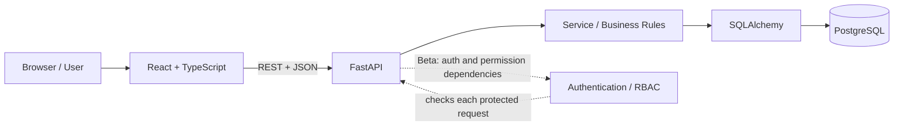
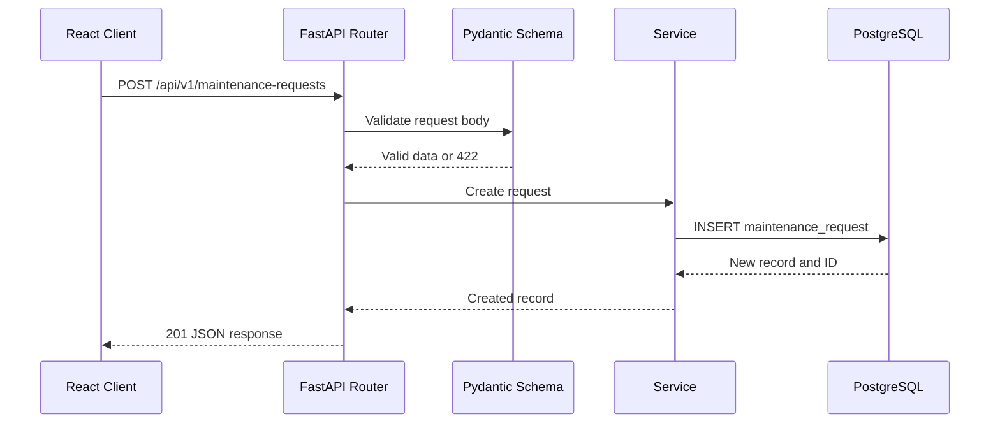
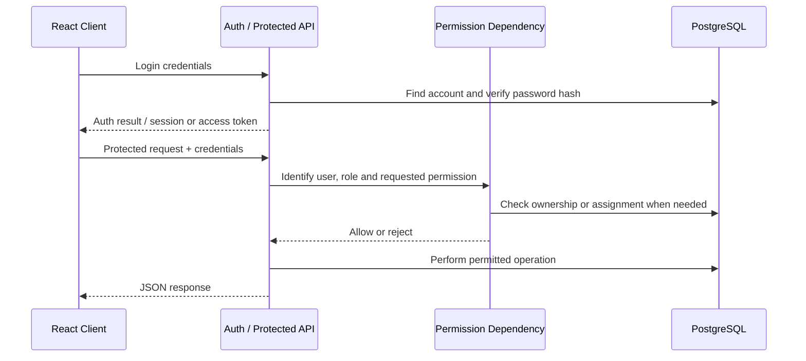
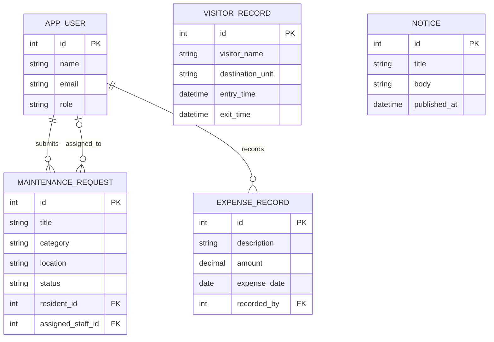
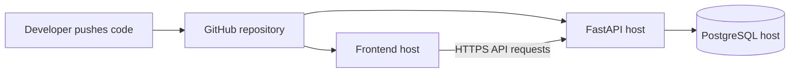

# Technical Design Document (TDD) — ApartmentCare

| Field | Value |
|---|---|
| Product | Apartment Building Management System (ApartmentCare) |
| Version | MVP + Beta |
| Releases | MVP — Mid-term, Beta — Final |
| Status | Draft |
| Related docs | [Product Requirements Document (PRD)](01-prd.md), [Software Requirements Specification (SRS)](02-srs.md) |

Sections and tables are marked **MVP** or **Beta**. Build the MVP parts for the mid-term; Beta extends the same application for the final.

**Documents in this set**

| Short form | Full form | Purpose | File |
|---|---|---|---|
| PRD | Product Requirements Document | What we build and why | [01-prd.md](01-prd.md) |
| SRS | Software Requirements Specification | Exact requirements, permissions and acceptance criteria | [02-srs.md](02-srs.md) |
| TDD | Technical Design Document | How we build it: architecture, data model and API (this document) | [03-tdd.md](03-tdd.md) |

## 1. Overview

- **MVP:** a React + TypeScript frontend calls a FastAPI REST API. PostgreSQL stores maintenance requests, visitor records and notices. The application runs locally for the mid-term demonstration.
- **Beta:** the same app gains login, five global roles, server-side permission checks, maintenance assignment, restricted visitor access and expense review.
- **Design principle:** keep the architecture simple enough for a course project. No microservices, AI features, or complex deployment infrastructure are required.

## 2. Tech stack

| Layer | Choice | Why | Release |
|---|---|---|---|
| Frontend | React + TypeScript | Required course stack; typed components and API models | MVP |
| Frontend build tool | Vite (recommended) | Simple local development server and build workflow | MVP |
| Backend API | FastAPI | Python REST API, request validation and OpenAPI docs | MVP |
| Validation / schemas | Pydantic | Validate JSON request and response data | MVP |
| ORM | SQLAlchemy 2.x | Maps Python models to PostgreSQL tables | MVP |
| Database | PostgreSQL | Persistent relational storage and foreign-key constraints | MVP |
| API client | Browser `fetch` or a small shared API service | Avoid duplicated HTTP logic | MVP |
| Authentication | JWT access token or a secure server-managed session | Authenticate Beta API requests; select one implementation and document it | Beta |
| Password hashing | `pwdlib` with Argon2 (or another approved password-hashing library) | Never store plaintext passwords | Beta |
| Authorization | FastAPI dependencies for roles, scopes and ownership | Enforce permission checks on the backend | Beta |
| Testing | `pytest` and FastAPI `TestClient`; frontend tests where feasible | Verify API behavior and access control | Beta |
| Configuration | Environment variables and `.env` locally | Keep secrets out of source control | MVP |
| Deployment | A straightforward host for frontend, API and PostgreSQL | Make final demo accessible; exact provider can be chosen later | Beta |

## 3. Architecture



The frontend never connects directly to PostgreSQL. All data access goes through FastAPI. The backend validates input, applies business rules, checks Beta permissions, and persists data using the ORM.

### 3.1 Request flow — MVP



### 3.2 Authentication and permission flow — Beta



## 4. Project structure

The following is a recommended structure. Keep existing repository conventions if the starter template already defines them.

```text
repository/
├── backend/
│   ├── app/
│   │   ├── main.py
│   │   ├── config.py
│   │   ├── database.py
│   │   ├── dependencies/
│   │   │   ├── auth.py
│   │   │   └── permissions.py
│   │   ├── maintenance/
│   │   │   ├── router.py
│   │   │   ├── schemas.py
│   │   │   ├── models.py
│   │   │   └── service.py
│   │   ├── visitors/
│   │   │   ├── router.py
│   │   │   ├── schemas.py
│   │   │   ├── models.py
│   │   │   └── service.py
│   │   ├── notices/
│   │   │   ├── router.py
│   │   │   ├── schemas.py
│   │   │   ├── models.py
│   │   │   └── service.py
│   │   ├── auth/                 # Beta
│   │   ├── expenses/             # Beta
│   │   └── users/                # Beta
│   ├── tests/
│   ├── requirements.txt
│   └── .env.example
├── frontend/
│   ├── src/
│   │   ├── components/
│   │   ├── pages/
│   │   ├── layouts/
│   │   ├── services/
│   │   │   └── api.ts
│   │   ├── types/
│   │   └── App.tsx
│   └── package.json
└── docs/
    ├── 01-prd.md
    ├── 02-srs.md
    └── 03-tdd.md
```

### 4.1 Backend responsibilities

- `main.py`: create the FastAPI app, register routers, configure API docs and health check.
- `database.py`: create the SQLAlchemy engine and provide a database session per request.
- `models.py`: define database tables and relationships.
- `schemas.py`: define Pydantic request/response schemas.
- `router.py`: define HTTP paths, status codes and dependencies.
- `service.py`: implement business rules and database operations.
- `dependencies/permissions.py`: Beta role, scope, ownership and assignment checks.
- `tests/`: API tests, validation tests and permission tests.

The router should not contain large blocks of business logic. It should validate the request, call a service function, and return a response.

## 5. Data model

### 5.1 `maintenance_request` table — MVP

| Column | Type | Rules |
|---|---|---|
| `id` | integer | Primary key, auto-increment |
| `title` | varchar(150) | Not null |
| `description` | varchar(2000) | Not null |
| `category` | varchar(80) | Not null |
| `location` | varchar(100) | Not null |
| `status` | varchar(20) | Not null, default `Pending` |
| `created_at` | timestamp with time zone | Not null |
| `updated_at` | timestamp with time zone | Not null |

### 5.2 `visitor_record` table — MVP

| Column | Type | Rules |
|---|---|---|
| `id` | integer | Primary key, auto-increment |
| `visitor_name` | varchar(120) | Not null |
| `destination_unit` | varchar(50) | Not null |
| `purpose` | varchar(200) | Not null |
| `entry_time` | timestamp with time zone | Not null |
| `exit_time` | timestamp with time zone | Nullable |
| `created_at` | timestamp with time zone | Not null |

### 5.3 `notice` table — MVP

| Column | Type | Rules |
|---|---|---|
| `id` | integer | Primary key, auto-increment |
| `title` | varchar(150) | Not null |
| `body` | varchar(3000) | Not null |
| `published_at` | timestamp with time zone | Not null |
| `created_at` | timestamp with time zone | Not null |
| `updated_at` | timestamp with time zone | Not null |

### 5.4 Beta tables and relationships

**`app_user`**

| Column | Type | Rules |
|---|---|---|
| `id` | integer | Primary key |
| `name` | varchar(100) | Not null |
| `email` | varchar(254) | Unique; normalized to lowercase |
| `password_hash` | varchar | Not null; never returned by API |
| `role` | varchar(30) | One of the five roles |
| `is_active` | boolean | Default `true` |
| `created_at` | timestamp with time zone | Not null |

**Additional columns on `maintenance_request` in Beta**

| Column | Type | Rules |
|---|---|---|
| `resident_id` | integer | Nullable during MVP; FK to `app_user.id` in Beta |
| `assigned_staff_id` | integer | Nullable FK to `app_user.id` |
| `work_notes` | text | Nullable |
| `completed_at` | timestamp with time zone | Nullable |

**`expense_record`**

| Column | Type | Rules |
|---|---|---|
| `id` | integer | Primary key |
| `description` | varchar(300) | Not null |
| `amount` | numeric(12,2) | Must be greater than zero |
| `expense_date` | date | Not null |
| `recorded_by` | integer | FK to `app_user.id` |
| `created_at` | timestamp with time zone | Not null |



Indexes should be added to frequently filtered columns such as maintenance status, creation time, resident ID, assigned staff ID, visitor entry time and expense date when needed.

### 5.5 Request and response schemas

| Schema | Used for | Main fields | Release |
|---|---|---|---|
| `MaintenanceCreate` | Create request | `title`, `description`, `category`, `location` | MVP |
| `MaintenanceUpdate` | Update request | Optional editable fields and `status` | MVP |
| `MaintenanceRead` | Maintenance response | All public maintenance fields and timestamps | MVP |
| `VisitorCreate` | Record arrival | `visitor_name`, `destination_unit`, `purpose`, `entry_time?` | MVP |
| `VisitorExitUpdate` | Record departure | `exit_time` | MVP |
| `VisitorRead` | Visitor response | Visitor fields and timestamps | MVP |
| `NoticeCreate` | Create notice | `title`, `body`, `published_at?` | MVP |
| `NoticeUpdate` | Update notice | Optional `title`, `body` | MVP |
| `NoticeRead` | Notice response | Notice fields and timestamps | MVP |
| `LoginRequest` | Log in | `email`, `password` | Beta |
| `UserRead` | User response | `id`, `name`, `email`, `role` | Beta |
| `MaintenanceAssignment` | Assign work | `assigned_staff_id` | Beta |
| `WorkUpdate` | Staff update | `status`, `work_notes?` | Beta |
| `ExpenseCreate` | Record expense | `description`, `amount`, `expense_date` | Beta |
| `ExpenseRead` | Expense response | Expense fields and creator ID/name as permitted | Beta |

## 6. REST API design

Base path: `/api/v1`. Request and response bodies use JSON. Exact schema names should be reflected in FastAPI's OpenAPI documentation.

### 6.1 Endpoints — MVP

| Method | Path | Purpose | Success | Errors |
|---|---|---|---|---|
| `GET` | `/api/health` | Backend health check | `200` | `500` |
| `POST` | `/api/v1/maintenance-requests` | Create maintenance request | `201` | `422` |
| `GET` | `/api/v1/maintenance-requests` | List maintenance requests | `200` | `422` |
| `GET` | `/api/v1/maintenance-requests/{id}` | View one request | `200` | `404` |
| `PATCH` | `/api/v1/maintenance-requests/{id}` | Update request | `200` | `404`, `422` |
| `DELETE` | `/api/v1/maintenance-requests/{id}` | Delete request in MVP demo | `204` | `404` |
| `POST` | `/api/v1/visitors` | Record visitor entry | `201` | `422` |
| `GET` | `/api/v1/visitors` | List visitor records | `200` | `422` |
| `GET` | `/api/v1/visitors/{id}` | View visitor record | `200` | `404` |
| `PATCH` | `/api/v1/visitors/{id}/exit` | Record visitor exit | `200` | `404`, `422` |
| `DELETE` | `/api/v1/visitors/{id}` | Delete visitor record in MVP demo | `204` | `404` |
| `POST` | `/api/v1/notices` | Create notice | `201` | `422` |
| `GET` | `/api/v1/notices` | List notices | `200` | `422` |
| `GET` | `/api/v1/notices/{id}` | View one notice | `200` | `404` |
| `PATCH` | `/api/v1/notices/{id}` | Update notice | `200` | `404`, `422` |
| `DELETE` | `/api/v1/notices/{id}` | Delete notice in MVP demo | `204` | `404` |

### 6.2 Endpoints — Beta

All endpoints below require authentication unless stated otherwise. The final implementation must document its chosen token/session mechanism.

**Authentication and profile**

| Method | Path | Who | Purpose | Success |
|---|---|---|---|---|
| `POST` | `/api/v1/auth/login` | Guest | Log in | `200` |
| `POST` | `/api/v1/auth/logout` | Authenticated user | Log out | `204` |
| `GET` | `/api/v1/users/me` | Authenticated user | View own profile | `200` |

**Maintenance workflow**

| Method | Path | Who | Purpose | Success |
|---|---|---|---|---|
| `POST` | `/api/v1/maintenance-requests` | Resident | Create a request tied to the caller | `201` |
| `GET` | `/api/v1/maintenance-requests` | Resident / Manager / Staff | List only records allowed by role and ownership | `200` |
| `PATCH` | `/api/v1/maintenance-requests/{id}/assignment` | Building Manager | Assign or unassign staff | `200` |
| `GET` | `/api/v1/staff/my-jobs` | Maintenance Staff | List assigned jobs | `200` |
| `PATCH` | `/api/v1/maintenance-requests/{id}/status` | Assigned Staff / Manager | Update permitted status and work notes | `200` |

**Visitor records**

| Method | Path | Who | Purpose | Success |
|---|---|---|---|---|
| `POST` | `/api/v1/visitors` | Security Guard / Manager | Record arrival | `201` |
| `GET` | `/api/v1/visitors` | Security Guard / Manager | View operational visitor log | `200` |
| `PATCH` | `/api/v1/visitors/{id}/exit` | Security Guard / Manager | Record departure | `200` |

**Notices and expenses**

| Method | Path | Who | Purpose | Success |
|---|---|---|---|---|
| `GET` | `/api/v1/notices` | All authenticated roles | Read notices | `200` |
| `POST` | `/api/v1/notices` | Building Manager | Create notice | `201` |
| `PATCH` | `/api/v1/notices/{id}` | Building Manager | Update notice | `200` |
| `DELETE` | `/api/v1/notices/{id}` | Building Manager | Delete notice | `204` |
| `POST` | `/api/v1/expenses` | Building Manager | Record expense | `201` |
| `GET` | `/api/v1/expenses` | Building Manager / Committee Member | View expense records | `200` |
| `GET` | `/api/v1/expenses/summary` | Building Manager / Committee Member | View expense totals | `200` |

### 6.3 Example request and response

Create a maintenance request:

```http
POST /api/v1/maintenance-requests
Content-Type: application/json
```

```json
{
  "title": "Water leakage in bathroom",
  "description": "Water is leaking near the sink.",
  "category": "Plumbing",
  "location": "Unit 4B"
}
```

Example success response:

```json
{
  "id": 1,
  "title": "Water leakage in bathroom",
  "description": "Water is leaking near the sink.",
  "category": "Plumbing",
  "location": "Unit 4B",
  "status": "Pending",
  "created_at": "2026-10-13T10:00:00Z",
  "updated_at": "2026-10-13T10:00:00Z"
}
```

### 6.4 Error format

Use FastAPI's standard validation format for invalid input and a consistent JSON detail for application errors. For example:

```json
{ "detail": "Maintenance request not found" }
```

Do not return stack traces, SQL statements, credentials or internal configuration in API responses.

### 6.5 API design rules

- Use plural resource names such as `/maintenance-requests`, `/visitors`, `/notices`, and `/expenses`.
- Use `GET` to read, `POST` to create, `PATCH` to partially update, and `DELETE` to remove resources.
- Keep business routes under `/api/v1`.
- Validate input on the backend with Pydantic.
- Return `404` for a resource that does not exist; use `403` when an authenticated caller lacks permission for a known operation.
- Use pagination for list endpoints if the record count grows.
- Do not trust a `resident_id`, `role`, or `assigned_staff_id` supplied by a normal client without validating it against the authenticated user and database.

## 7. Database access

- `database.py` creates the SQLAlchemy engine using a `DATABASE_URL` environment variable.
- A FastAPI dependency yields one database session per request and closes it afterward.
- Local development uses PostgreSQL as specified by the project plan.
- Table definitions and relationships live in backend models; request/response schemas are separate from ORM models.
- For MVP, schema creation may use a simple documented setup or SQLAlchemy metadata for the local demo. If the team adopts Alembic, use migrations for subsequent changes.
- Use ORM parameters rather than building SQL strings from user input.
- Add database constraints for required fields, unique email and positive expense amounts where appropriate.
- The frontend must never connect directly to PostgreSQL or contain database credentials.

## 8. Configuration

| Variable | Purpose | Release |
|---|---|---|
| `DATABASE_URL` | PostgreSQL connection string | MVP |
| `JWT_SECRET` or session secret | Sign tokens or protect session data; only if the selected auth approach requires it | Beta |
| `ACCESS_TOKEN_MINUTES` | Access-token lifetime, if JWT is selected | Beta |
| `FRONTEND_ORIGIN` | Allowed frontend origin for CORS during development/deployment | MVP |
| `ENVIRONMENT` | Distinguish local development from production | MVP |

- Keep local secrets in `.env`, and ensure `.env` is in `.gitignore`.
- Commit `.env.example` with placeholder values only.
- Never commit real passwords, tokens or production connection strings.
- Configure CORS to allow only the known frontend origin when frontend and backend use different origins.

## 9. Deployment



- MVP runs locally for the mid-term demonstration.
- Beta is deployed to a selected frontend and backend host connected to PostgreSQL.
- The team will document environment variables and setup instructions before the final demo.
- Deployment provider and URL are intentionally undecided until the team confirms hosting access.

## 10. Authentication and RBAC design — Beta

### 10.1 Authentication

- Users authenticate through the FastAPI backend.
- Passwords are stored only as hashes using a password-hashing library such as Argon2.
- The API returns a minimal user profile; password and password hash are never included.
- The team will choose either a short-lived JWT access token approach or a secure server-managed session before implementing authentication.
- If JWT is selected, the secret is stored in an environment variable, tokens expire, and protected endpoints validate the token on every request.
- Logout must invalidate the session or applicable refresh/session token according to the selected implementation.

### 10.2 Roles and permissions

Use a central permission dependency or helper rather than repeating role logic in every route. Example conceptual permissions:

| Permission | Allowed roles |
|---|---|
| `maintenance:create` | Resident, Building Manager |
| `maintenance:read_own` | Resident |
| `maintenance:manage` | Building Manager |
| `maintenance:assign` | Building Manager |
| `maintenance:update_assigned` | Maintenance Staff |
| `visitor:record` | Security Guard, Building Manager |
| `visitor:read` | Security Guard, Building Manager |
| `notice:read` | All authenticated roles |
| `notice:manage` | Building Manager |
| `expense:create` | Building Manager |
| `expense:read` | Building Manager, Committee Member |

These permission names are an implementation guide. The backend must also verify resource ownership and assignment; a matching role alone does not grant access to every record.

### 10.3 Authorization dependencies

Conceptual FastAPI pattern:

```python
def require_permission(permission: str):
    # Return a dependency that:
    # 1. gets the authenticated user,
    # 2. checks the user's role and permission,
    # 3. raises HTTP 403 if access is denied,
    # 4. returns the user if allowed.
    ...
```

The pseudocode is illustrative, not a complete implementation. Do not implement authorization only by hiding frontend buttons.

## 11. Testing strategy

| Test level | What to test | Release |
|---|---|---|
| Schema/unit tests | Required fields, lengths, valid status values, positive expense amount, visitor time order | MVP/Beta |
| API tests | CRUD operations, response codes, missing IDs and validation errors | MVP |
| Database tests | Records persist and relationships/constraints behave correctly | MVP/Beta |
| Authentication tests | Valid login, invalid credentials, logout, expired/invalid token | Beta |
| Authorization tests | Each role can perform permitted actions and receives `403` for forbidden actions | Beta |
| Ownership tests | Residents cannot access another resident's private request; staff cannot update unassigned jobs | Beta |
| Frontend integration tests | Core forms and lists handle successful and failed API responses | MVP/Beta |
| Regression tests | Existing MVP flows continue to work after Beta features are added | Beta |

Use test data with clearly fictional names and avoid putting real resident or visitor information into the repository.

## 12. Implementation milestones

### MVP — Mid-term
1. Create backend settings and PostgreSQL session handling.
2. Define models and schemas for maintenance requests, visitors and notices.
3. Implement the CRUD and visitor entry/exit endpoints.
4. Verify validation and error handling in `/api/docs`.
5. Connect React pages to the API and demonstrate the main workflows.
6. Document local setup and confirm data persists after restart.

### Beta — Final
1. Add user accounts and authentication.
2. Add roles, permission dependencies and resource-level checks.
3. Implement maintenance assignment and staff work updates.
4. Restrict visitor records and notice management according to role.
5. Add expense records and committee read-only review.
6. Add automated tests for core flows and forbidden actions.
7. Configure deployment and update documentation with the live URL.

## 13. Key design decisions and open questions

| ID | Decision / question | Current direction |
|---|---|---|
| D-1 | How many buildings? | One building for this course project |
| D-2 | How are accounts created? | Registration or manager provisioning; finalize before Beta |
| D-3 | How are sessions handled? | Choose JWT or secure server-managed sessions before implementation |
| D-4 | Who can see visitor records? | Security Guard and Building Manager by default; confirm building policy |
| D-5 | Can committee members edit expenses? | Read-only in the planned Beta |
| D-6 | Where will the app be hosted? | Choose a simple provider after checking team/course requirements |
| D-7 | Can residents delete maintenance requests? | MVP demo permits deletion; Beta should restrict deletion according to manager policy |
